# FH2MP: Forza Horizon 2 online, back from the dead (sort of)

> **v1.5.1.** It works and it is young: expect crashes, desyncs and rough edges.
> Known problems: [open issues](https://github.com/Charelene/FH2MP/issues) and the [help pages](https://forza.scuffed.af/help/). Changes per version: [Releases](https://github.com/Charelene/FH2MP/releases).

[](https://www.patreon.com/fh2mp)

Microsoft switched off Forza Horizon 2's online services on 2023-08-22. FH2MP brings them back: the **real game client**, speaking the
**game's own network protocol**, to a **replacement server** written from scratch. Two or more people can find each other through a Car Meet,
drive in the same Online Free Roam world, race, run Road Trip events, share paint jobs and tunes, join Car Clubs and climb the Rivals and
leaderboard pages.

The game is the Xbox One build, run on a PC by [Azimuth](https://almost-there-games.itch.io/azimuth) (a compatibility layer that answers every
online call as "offline"). FH2MP puts the online half back with two pieces, and players get them through a third:

- a **shim** (`fh2-mods\FH2MP.dll`, a mod for the [FH2 Mod Platform](https://github.com/Trinculo54/fh2-mod-platform)) that runs inside the
  game and re-enables real sockets, gives each install its own identity and redirects the game's web-service calls to our server. It works
  next to the other FH2 mods: the platform checks its changes to the game against theirs;
- a **server** that speaks the game's UDP protocol (lobbies, worlds, relay) and stands in for the Turn 10 and Xbox Live HTTP services. It is
  written in Go (`native/`) and spreads busy worlds over several CPU cores. It was checked byte for byte against the earlier Python version,
  which was removed after the 1.2.0 release (it is in the git history up to that point);
- **Encore**, the launcher (a project of its own) that signs you in, keeps everything up to date, starts the game and brings the in-game
  Guide. Up to 1.4.8 the FH2MP Launcher (Qt) in this repository did that.

The protocol was recovered from the game client itself, not from captured Microsoft traffic. No Microsoft or Xbox Live service is ever
contacted. There was nothing left to sniff.

<details>
<summary>Screenshots</summary>

All from real game clients running against our server.

<table>
<tr><td colspan="2">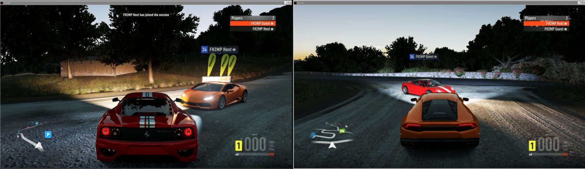<br>Online Free Roam, two clients.</td></tr>
<tr><td colspan="2">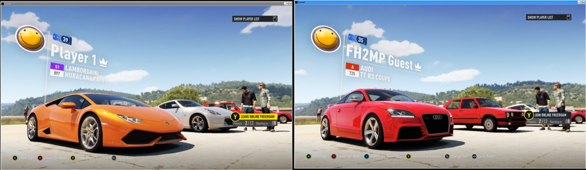<br>Car Meet: one player starts Online Free Roam, the other gets the invite.</td></tr>
<tr><td colspan="2">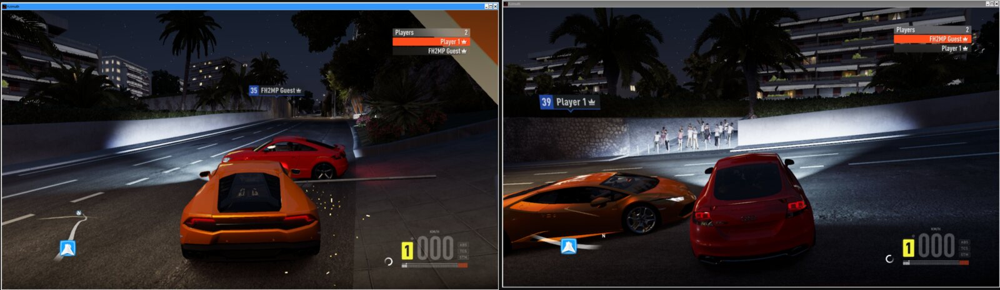<br>After the invite: the same world, found through the game's own matchmaking.</td></tr>
<tr><td colspan="2">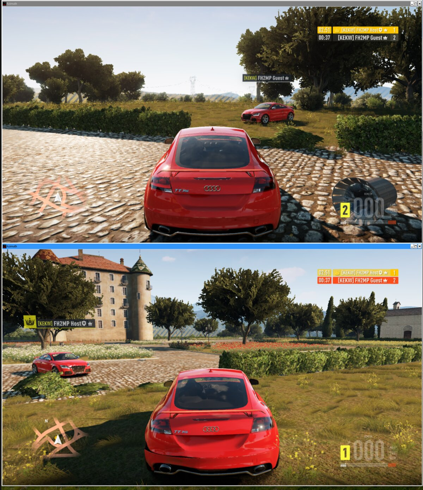<br>Road Trip, King: the server crowns a player and moves the crown on collisions.</td></tr>
<tr><td colspan="2">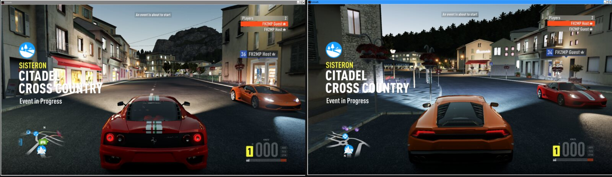<br>Online event: invite, car select, grid, race.</td></tr>
<tr>
<td width="50%">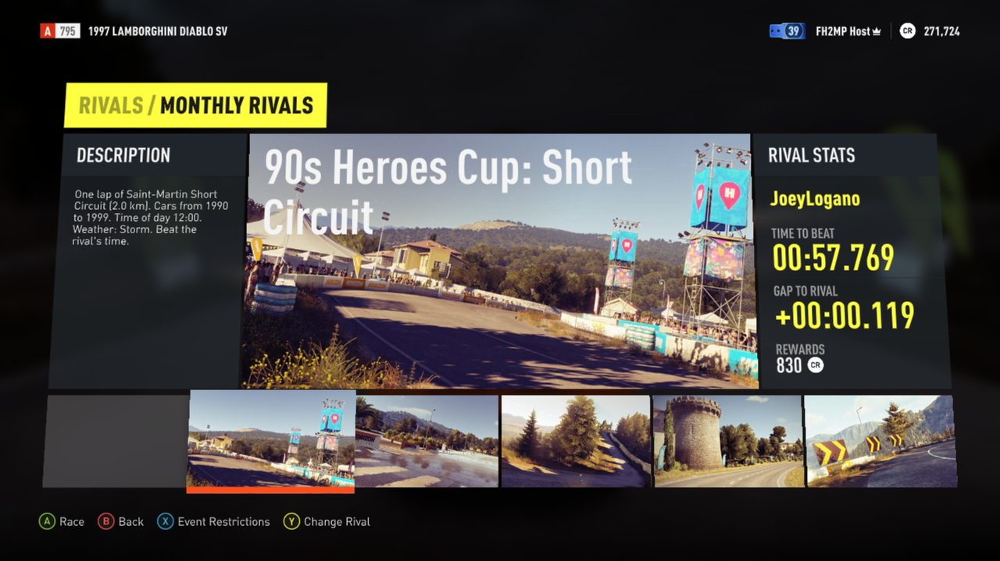<br>Monthly Rivals, generated by the server.</td>
<td width="50%">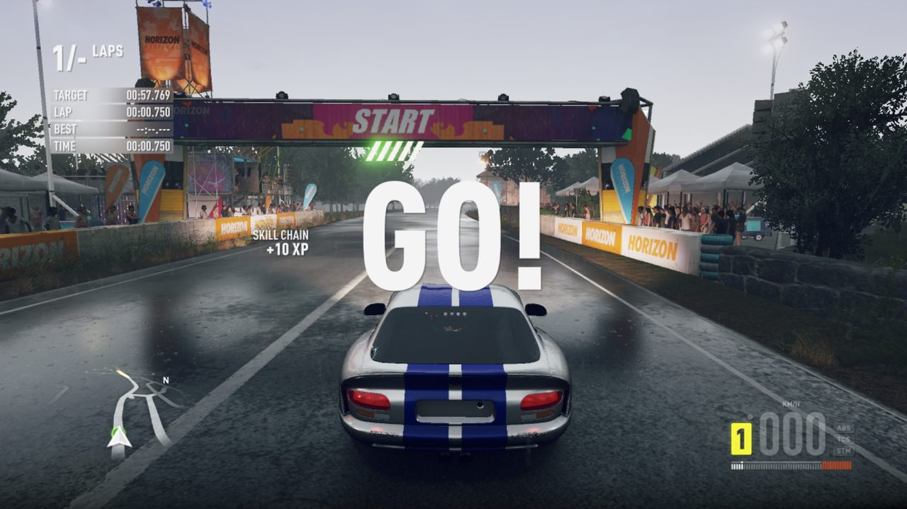<br>The same event in game.</td>
</tr>
<tr>
<td width="50%">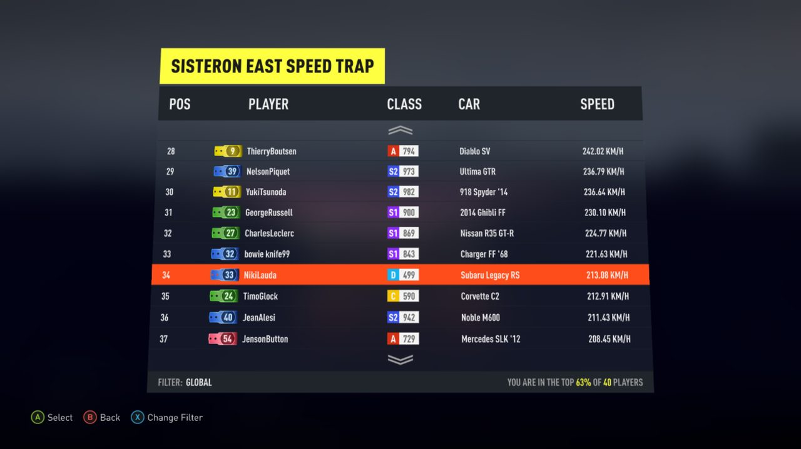<br>Speed trap leaderboard.</td>
<td width="50%">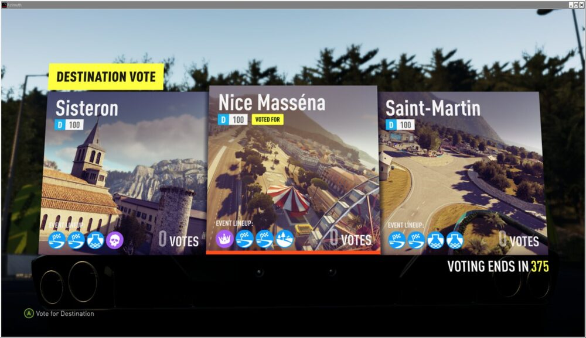<br>Online Road Trip vote.</td>
</tr>
<tr><td colspan="2">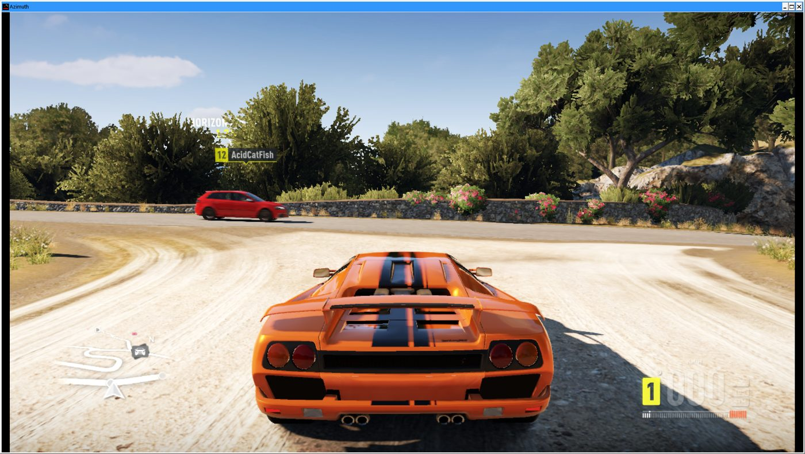<br>Paint jobs: shared on one client, downloaded on the other.</td></tr>
<tr><td colspan="2">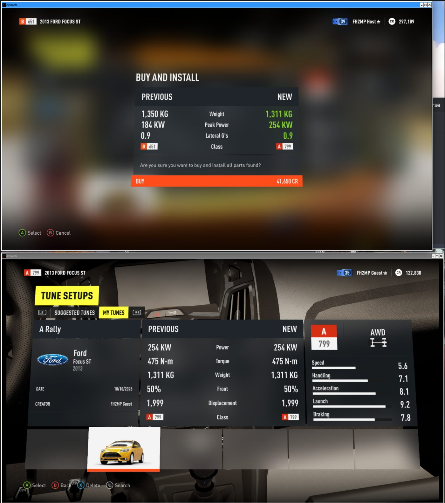<br>Tunes: Tune Setups, then Buy and Install.</td></tr>
<tr><td colspan="2">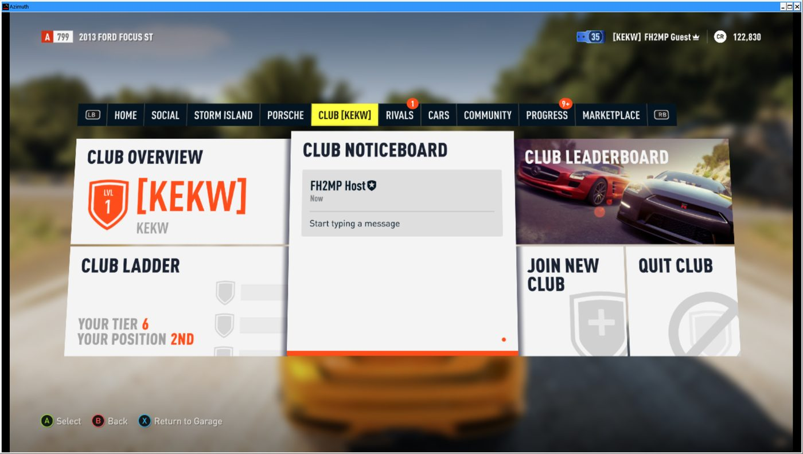<br>Car Clubs: tag, overview, noticeboard, ladder, leaderboard.</td></tr>
</table>

</details>

Open bugs are in the [issue tracker](https://github.com/Charelene/FH2MP/issues).

## Install (players)

**You need:** a legitimately owned copy of Forza Horizon 2 (Xbox One build **1.0.0.64**) and [Azimuth **1.0.4**](https://almost-there-games.itch.io/azimuth),
set up so the game starts in Azimuth. No game files are in this repo or in Encore.

Players use **Encore**, the launcher for the FH2MP service (it replaced the FH2MP Launcher in 1.5.0). It signs you in, installs and
updates the shim, the [FH2 Mod Platform](https://github.com/Trinculo54/fh2-mod-platform), [FH2 Extra Options](https://github.com/RokkuDayo/ForzaHorizon2_ExtraOptions)
and the other mods FH2MP supports (pinned builds, checked by SHA-256), starts the game and brings the in-game Guide (friends, messages,
voice, achievements).

1. Download Encore from the [latest FH2MP release](https://github.com/Charelene/FH2MP/releases/latest): `EncoreSetup-<version>.exe`
   on Windows, `Encore-<version>-x86_64.AppImage` on Linux (`chmod +x` it, then run).
2. Start it and follow its first run: your account, your **Azimuth folder** (the one with `azimuth.exe`) and the game's folder. Mods you
   already have in `fh2-mods` keep working.
3. Press **Play**.

**Coming from the FH2MP Launcher (1.4.x).** It updates itself to Encore: press **Update** when it says it is too old. Encore takes over
your account, your Azimuth folder and your game folders; nothing in the Azimuth folder is lost.

**Updates.** Encore checks FH2MP's signed release manifest and installs the shim it names; every release is signed, nothing unsigned is
installed. The server refuses launchers and shims older than the minimum it announces (from 1.5.0: Encore 2.1.0), so an old install says
it needs an update before it can play.

FH2MP 1.5.1 is made for Azimuth 1.0.4, FH2 Extra Options 0.6.1, FH2 Mod Platform 2.9.1, HonkHonk 1.0.0 and FH2 ANNA 1.2.4; Achievements
1.0.2, NitroSystem 2.0.1, Underglow 1.1.1 and PoliceLightbars 0.2.2 are optional. Encore installs that combination from FH2MP's server
(the authors' releases are the fallback) and checks every file against its pinned hash.

**Linux.** Azimuth runs under Wine/Proton. The game has to start with `WINEDLLOVERRIDES="winmm,dwrite,d3dcompiler_47=n,b"`, so Wine loads
FH2 Extra Options (`winmm.dll`) and the FH2 Mod Platform (`DWrite.dll` and `d3dcompiler_47.dll`) instead of its own DLLs (see the
platform's [Linux notes](https://github.com/Trinculo54/fh2-mod-platform/blob/main/docs/linux.md)); Encore does that when it starts the
game. Starting Azimuth from Steam instead? Use the same value in its launch options: `WINEDLLOVERRIDES="winmm,dwrite,d3dcompiler_47=n,b" %command%`.
Tested on Proton-CachyOS 11; distro Wine is usually too old for Azimuth.

**Windows.** Tested on Windows 10 and 11.

### If something goes wrong

Check the [help pages](https://forza.scuffed.af/help/) and the [open issues](https://github.com/Charelene/FH2MP/issues), then [open an issue](https://github.com/Charelene/FH2MP/issues/new/choose) with these files from the
`data` folder inside your Azimuth folder:

- `data\logs\azimuth.log` (always) and the newest `.dmp` in `data\logs` for a crash;
- `data\bin\fh2mp.log` (the shim's log) and, next to `azimuth.exe`, `fh2-mods\platform.log` (the FH2 Mod Platform and every mod) and the
  newest report in `fh2-mods\crashes` for a crash;
- `data\azimuth.ini` if you changed settings.

Encore keeps its own logs with its settings (`%APPDATA%\Encore` on Windows). None of these files contain passwords or keys.

## Build from source

Sources: `shim/` (C), `native/` (the server and the release tool, Go), `proto/` (the chat schema), `release/` (packaging and signing).
Encore, with the in-game Guide (`FH2MPGuide.dll`) and the chat client, is a project of its own; the FH2MP Launcher (`launcher/`, Python),
the Guide (`guide/`) and the chat client (`client/`) were here up to 1.4.8 and are in the git history.

**Shim.** Needs `x86_64-w64-mingw32-gcc` (and `windres`). It compiles against the FH2 Mod Platform's API header in
`paddock/third_party/fh2-mod-platform` (the Paddock submodule).

```sh
shim/build.sh          # release build -> shim/build/FH2MP.dll
shim/build.sh debug    # research build -> shim/build/FH2MP-debug.dll (live debugger port, tracer, probes). Never ship it.
release/build_shim_zip.sh   # dist/fh2mp-shim-<version>.zip: fh2-mods/FH2MP.dll (the platform is not in it; Encore fetches it)
```

The version comes from `shim/VERSION`. A `-debug` shim is never replaced by the launcher's updater (Encore's, as the FH2MP Launcher's was).

**Server.** Needs Go 1.27 or newer and PostgreSQL; the game data is loaded into the `game` schema with the tools of an install you own, so it
is not in this repository. It builds to two programs:

```sh
cd native
go build -o fh2mp-lsp ./cmd/fh2mp-lsp        # the web services: fh2mp-lsp [port]
go build -o fh2mp-server ./cmd/fh2mp-server   # the game server: fh2mp-server [port] [logfile]
go vet ./... && go test ./...                 # or release/ci.sh go
```

`FH2MP_WORKERS` sets how many goroutines run the worlds (default: cores - 1). The game server's tests replay recorded runs of the earlier Python
server and compare every datagram and log line (`native/testdata`, frozen since that server was removed); the tests that need a database make
their own scratch databases on the PostgreSQL named by `FH2MP_TEST_PG_ADMIN_DSN` (an account that may create databases).

**Release.** `release/publish.sh vX.Y.Z[-rcN]` checks that the tag and `shim/VERSION` agree, scans for personal paths, pushes, waits for
the commit's checks and tags. The workflow in `.github/workflows/release.yml` then builds and signs the shim, takes Encore's files named
in `release/launcher.json` from Encore's release (each checked against its SHA-256 and size), builds and signs `manifest.json` with
`native/cmd/fh2mp-release` and the Ed25519 key in the `RELEASE_SIGNING_KEY` secret (its public half is `release/release-key.pub`, which
Encore and the 1.4.x launchers embed) and publishes the GitHub release, using `release/notes/<tag>.md` as the description when that file
exists. `fh2mp-release keygen <file>` makes a signing key.

## Supported setups

- Forza Horizon 2, Xbox One build 1.0.0.64.
- **Azimuth 1.0.4** only. The shim checks its hooks against byte signatures of that build and skips anything that does not match;
  Encore warns you about other builds.
- **FH2 Mod Platform 2.9.1** by Trinculo54, the `DWrite.dll` and `d3dcompiler_47.dll` next to `azimuth.exe` that load the shim. Encore
  installs the 2.9.1 release when your folder has another build.
- **[FH2 Extra Options](https://github.com/RokkuDayo/ForzaHorizon2_ExtraOptions) 0.6.1** by RokkuDayo, the only supported build. When the `winmm.dll` next to `azimuth.exe` is not that build, Encore downloads the author's release.
  It keeps its mods in `mods\Forza Horizon 2` and moves the ones in `mods` there itself the first time the game starts.
  By hand, put its `winmm.dll`, `FH2_ExtraOptions.ini` and `mods\Forza Horizon 2` next to `azimuth.exe`.
- Other FH2 Mod Platform mods load next to the shim; the platform refuses any hook of theirs that would overlap one of ours. Online play uses the server's car
  database, so their **database** changes are off while you play online (`platform.log` and the title screen say so). A
  car database another mod put in `mediaoverride` (traffic cars, a car pack's) is kept in `fh2mp\gamedb-kept.slt` while you play online
  and put back when you start the game offline; if you then remove it from `mediaoverride`, it isn't put back
  again. With FH2MP turned off or removed, nothing puts it back: copy that file to `mediaoverride\Stripped\gamedbRC.slt` yourself. With
  nothing kept, the server's database stays in `mediaoverride` offline too, so a car pack's database in `mediapc` isn't read. With FH2
  Mod Platform 2.7.1, a mod's database changes are still made on the game's own database, not on the one put back.
- Windows 10/11, or Linux with Proton/Wine.

## AI disclosure

This project is **AI-assisted**. If that makes you close the tab, fair enough. It is a tool that lets one person get through work that used to need a team, and the output is judged the old way: does the client connect, does the packet decode, does the car show up on the other screen. The bugs are ours either way.

## Legal and ethics

- Unofficial fan research for interoperability with a game you own. Not affiliated with or endorsed by Microsoft, Turn 10, Playground Games or Azimuth developer.
- No game files, Azimuth binaries or extracted assets are included or may be contributed.
- The server only talks to clients you point at it and never contacts Microsoft or Xbox Live services.

## Related projects

- **Azimuth** by Almost There Games: the layer that makes any of this possible.
- **[FH2 Extra Options](https://github.com/RokkuDayo/ForzaHorizon2_ExtraOptions)** by RokkuDayo: quality-of-life patches, loaded next to the shim.
- **[FH2 Mod Platform](https://github.com/Trinculo54/fh2-mod-platform)** by Trinculo54: the shared base the shim is built on (loading,
  shared hooks checked against other mods and Extra Options, crash reports).
- **[HonkHonk](https://github.com/suderek22/FH2_HonkHonk)** by suderek22: horns, heard by the other players online.
- **[FH2 ANNA](https://github.com/qiangqiang101/FH2-ANNA)** by qiangqiang101: headlights, display mode, pad and Auto Drive.
- **[Achievements](https://github.com/Trinculo54/fh2-achievements)** by Trinculo54 (optional): the achievements the server keeps and the
  Guide shows.
- **[NitroSystem](https://github.com/qiangqiang101/FH2-NitroSystem)** by qiangqiang101 (optional): nitro, switched off by FH2MP where it
  isn't allowed online through its own off switch.
- **[Underglow](https://github.com/qiangqiang101/FH2-Underglow)** by qiangqiang101 (optional): underglow, shown to the other players online.
- **[PoliceLightbars](https://github.com/suderek22/FH2_Lightbars)** by suderek22 (optional): amber and blue roof lightbars from FH6 on 31
  cars, shown to the other players who have it and flashing by each owner's Police lights switch; the server serves a copy of its car
  database with the add-on's own rows (`native/internal/addons`).
- **[QuickChat](https://github.com/Trinculo54/QuickChat)** by Trinculo54 (optional): 16 fixed phrases in FH2 ANNA's menu; FH2MP carries
  the phrase a player picks to the other players of the world and shows it over the sender's car (`native/internal/game/quickchat.go`).

Code contributed to FH2MP itself by **Trinculo54**: the Modded cars row of Event Options, the developer badge on name tags, quick chat and
crash guards in the shim (and the in-game Guide's Xbox 360 and Xbox One looks, which moved to Encore with the Guide).

## License

[GPL-3.0](LICENSE). The game, Azimuth and the mods mentioned above belong to their respective authors and are not covered by it.

Third-party mods FH2MP uses (not part of FH2MP and not redistributed by it; Encore downloads their authors' own releases):

- **FH2 Mod Platform** © 2026 Trinculo54, [MIT License](paddock/third_party/fh2-mod-platform/LICENSE). Its API header (`fh2mod.h`, release
  v2.9.1 as `VERSION` says) lives in the Paddock submodule at `paddock/third_party/fh2-mod-platform`, and the shim is built against it. The
  DLL itself is not in this repository or in FH2MP's releases: Encore downloads the author's release zip (pinned by the zip's and the DLL's
  SHA-256, `encore-fh2` `pins.rs` `PLATFORM`) when the Azimuth folder has no platform or an older one. To move to a newer platform, update the
  header, `LICENSE` and `VERSION` in the Paddock; Encore's pin moves with it. The platform includes [MinHook](https://github.com/TsudaKageyu/minhook)
  © 2009-2017 Tsuda Kageyu (BSD 2-Clause) and [SQLite](https://sqlite.org) (public domain); Encore keeps the release's
  `LICENSE.txt` (as `LICENSE-FH2ModPlatform.txt`) and `LICENSE-MinHook.txt` next to the DLL.
- **[FH2 Extra Options](https://github.com/RokkuDayo/ForzaHorizon2_ExtraOptions)** © RokkuDayo, GPL-3.0.
- **[HonkHonk](https://github.com/suderek22/FH2_HonkHonk)** © suderek22, GPL-3.0.
- **[FH2 ANNA](https://github.com/qiangqiang101/FH2-ANNA)** © qiangqiang101, MIT License.
- **[Achievements](https://github.com/Trinculo54/fh2-achievements)** © Trinculo54, GPL-3.0.
- **[NitroSystem](https://github.com/qiangqiang101/FH2-NitroSystem)** © qiangqiang101, MIT License.
- **[Underglow](https://github.com/qiangqiang101/FH2-Underglow)** © qiangqiang101, MIT License.
- **[PoliceLightbars](https://github.com/suderek22/FH2_Lightbars)** © suderek22, MIT License. The server runs its 0.2.2 DLL's SQL
  statements (copied into `native/internal/addons/lightbars.go`) on its car database.
- **[QuickChat](https://github.com/Trinculo54/QuickChat)** by Trinculo54 (optional): 16 fixed phrases in FH2 ANNA's menu; FH2MP carries
  the phrase a player picks to the other players of the world and shows it over the sender's car (`native/internal/game/quickchat.go`).

Libraries the server and the release tool (`native/`) are built with (Go modules, compiled in; `native/go.mod` has the versions):

- **[gotd/td](https://github.com/gotd/td)** © 2020 Aleksandr Razumov, MIT License: the MTProto chat server's protocol code and the TL code
  generator (`native/internal/mt`).
- **[gotd/ige](https://github.com/gotd/ige)** © 2018 Karl McGuire, MIT License.
- **[pgx](https://github.com/jackc/pgx)** © 2013-2021 Jack Christensen, MIT License: PostgreSQL.
- **[modernc.org/sqlite](https://gitlab.com/cznic/sqlite)** © 2017 The Sqlite Authors, BSD 3-Clause: the game's car database.
- **[regexp2](https://github.com/dlclark/regexp2)** © Doug Clark, MIT License.
- **[xz](https://github.com/ulikunitz/xz)** © 2014-2022 Ulrich Kunitz, BSD 3-Clause.
- **[multierr](https://github.com/uber-go/multierr)** © 2017-2021 Uber Technologies, MIT License.
- **[golang.org/x/text](https://cs.opensource.google/go/x/text)** © 2009 The Go Authors, BSD 3-Clause.
