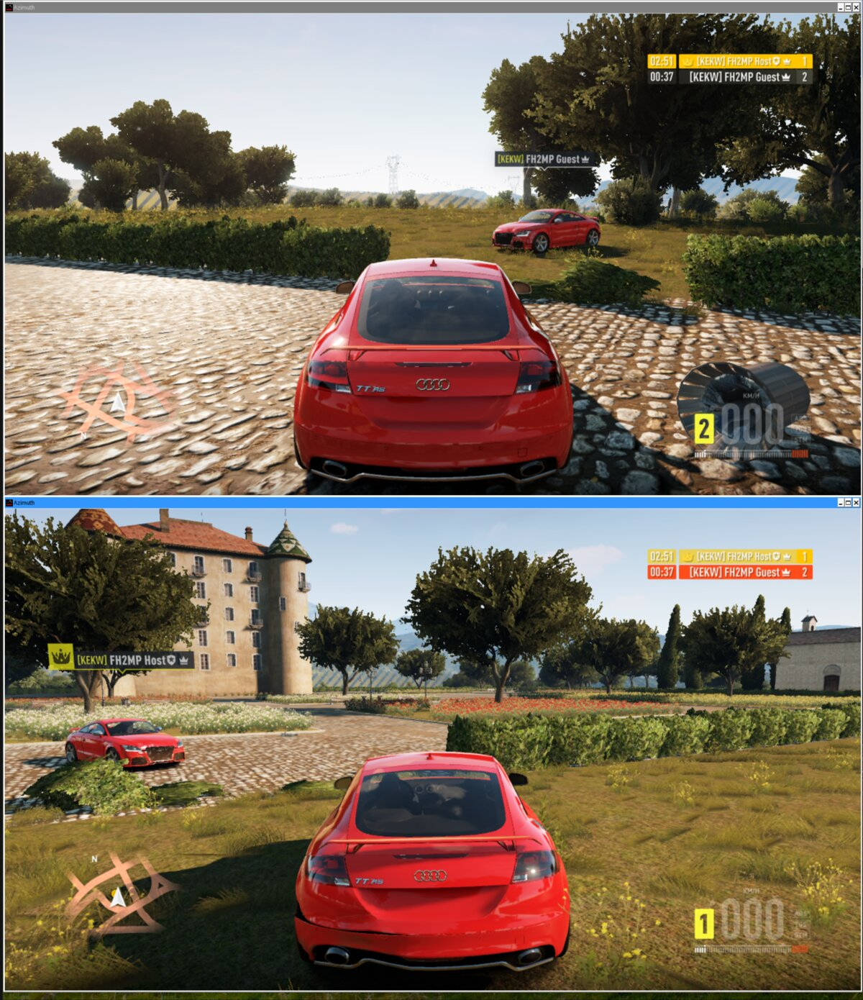
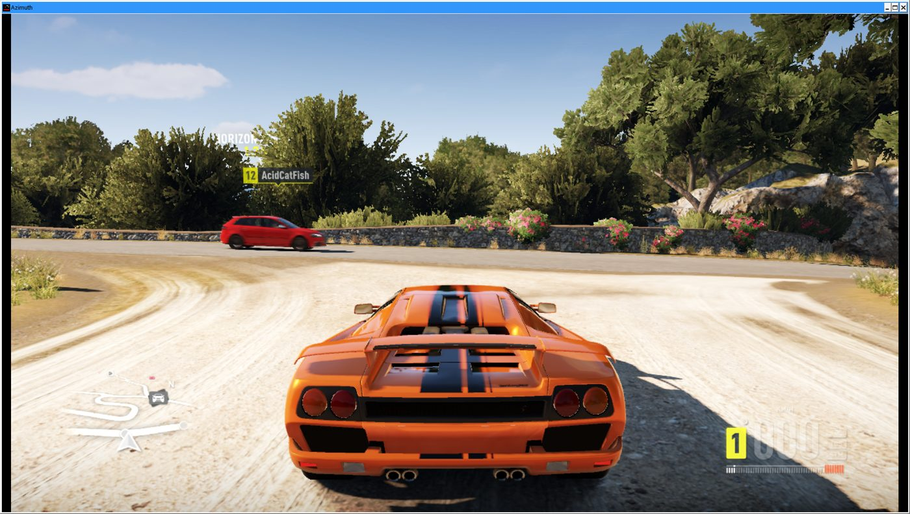
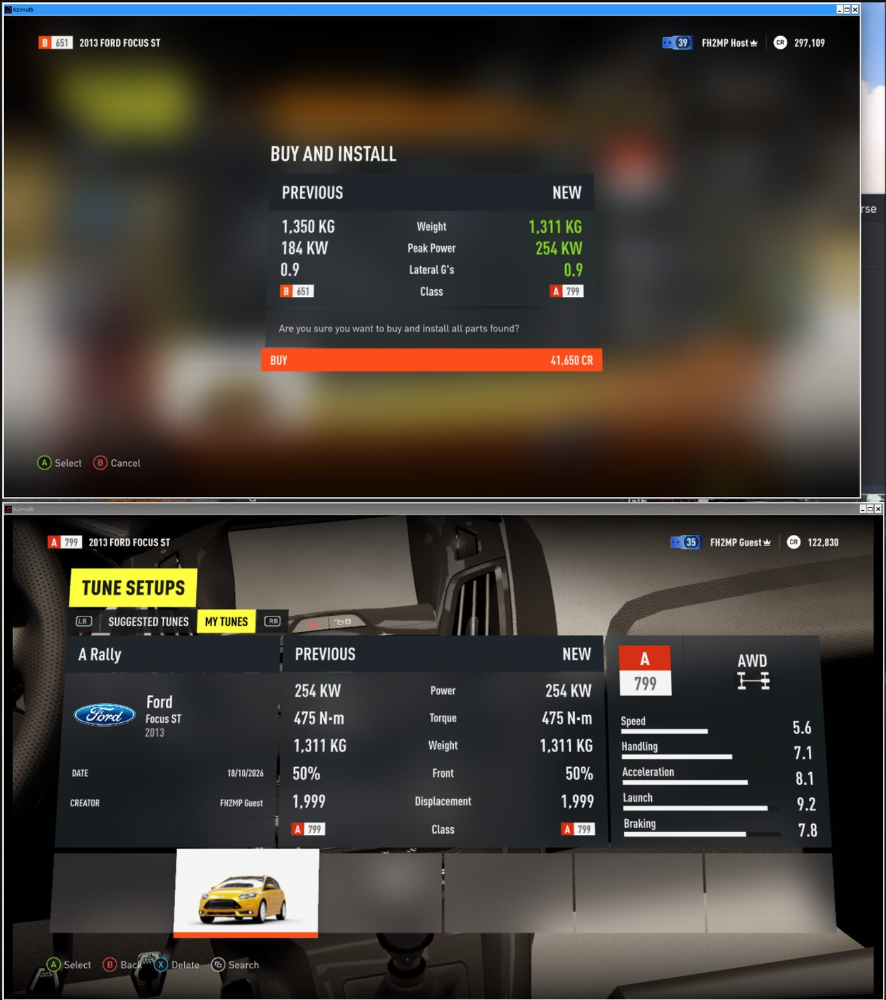
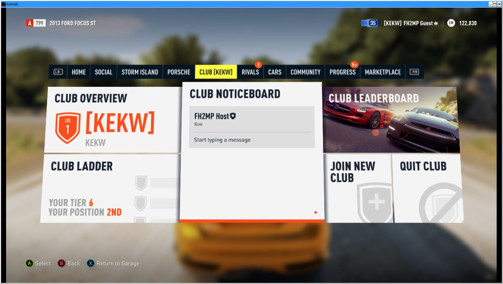

# FH2MP: Forza Horizon 2 online, back from the dead (sort of)

> **v1.0.0-rc5, a pre-release.** It works and it is young: expect crashes, desyncs and rough edges.
> Known problems and workarounds: [KNOWN_ISSUES.md](KNOWN_ISSUES.md). Changes per version: [Releases](https://github.com/Charelene/FH2MP/releases).

Microsoft switched off Forza Horizon 2's online services on 2023-08-22. FH2MP brings them back: the **real game client**, speaking the
**game's own network protocol**, to a **replacement server** written from scratch. Two or more people can find each other through a Car Meet,
drive in the same Online Free Roam world, race, run Road Trip events, share paint jobs and tunes, join Car Clubs and climb the Rivals and
leaderboard pages.

The game is the Xbox One build, run on a PC by [Azimuth](https://almost-there-games.itch.io/azimuth) (a compatibility layer that answers every
online call as "offline"). FH2MP puts the online half back with three pieces:

- a **launcher** (Qt) that signs you in, keeps everything up to date and starts the game;
- a **shim** (`winmm.dll` proxy) that runs inside the game and re-enables real sockets, gives each install its own identity and redirects the
  game's web-service calls to our server;
- a **server** (Python) that speaks the game's UDP protocol (lobbies, worlds, relay) and stands in for the Turn 10 and Xbox Live HTTP services.

The protocol was recovered from the game client itself, not from captured Microsoft traffic. No Microsoft or Xbox Live service is ever
contacted. There was nothing left to sniff.

<details>
<summary>Screenshots</summary>

All from real game clients running against our server.

<table>
<tr><td colspan="2"><br>Online Free Roam, two clients.</td></tr>
<tr><td colspan="2"><br>Car Meet: one player starts Online Free Roam, the other gets the invite.</td></tr>
<tr><td colspan="2"><br>After the invite: the same world, found through the game's own matchmaking.</td></tr>
<tr><td colspan="2"><br>Road Trip, King: the server crowns a player and moves the crown on collisions.</td></tr>
<tr><td colspan="2"><br>Online event: invite, car select, grid, race.</td></tr>
<tr>
<td width="50%"><br>Monthly Rivals, generated by the server.</td>
<td width="50%"><br>The same event in game.</td>
</tr>
<tr>
<td width="50%"><br>Speed trap leaderboard.</td>
<td width="50%"><br>Online Road Trip vote.</td>
</tr>
<tr><td colspan="2"><br>Paint jobs: shared on one client, downloaded on the other.</td></tr>
<tr><td colspan="2"><br>Tunes: Tune Setups, then Buy and Install.</td></tr>
<tr><td colspan="2"><br>Car Clubs: tag, overview, noticeboard, ladder, leaderboard.</td></tr>
</table>

</details>

Details and open bugs are in [KNOWN_ISSUES.md](KNOWN_ISSUES.md).

## Install (players)

**You need:** a legitimately owned copy of Forza Horizon 2 (Xbox One build **1.0.0.64**) and [Azimuth **0.9.10**](https://almost-there-games.itch.io/azimuth),
set up so the game starts in Azimuth. No game files are in this repo or the launcher.

1. Download the launcher from the [latest release](https://github.com/Charelene/FH2MP/releases/latest):
   - Windows: `...-windows-x64-setup.exe` (installer) or `...-windows-x64-portable.zip` (unpack anywhere, run `fh2mp-launcher.exe`);
   - Linux: `...-x86_64.AppImage` (`chmod +x` it, then run) or `fh2mp-launcher_<version>_amd64.deb`.
2. Start it. The first run asks for your **Azimuth folder** (the one with `azimuth.exe`), installs the shim and the FH2 Extra Options mod
   if they are missing, and makes your account.
3. Pick a gamertag and press **PLAY**. The launcher starts the game for you.

**Account.** There is no e-mail or password. Your account is a secret key stored in the OS keyring; you get a **recovery code** to move it to
another computer. Keep that code private.

**Updates.** The launcher checks the signed release manifest and updates itself and the shim. Every release is signed; nothing unsigned is
installed. The server refuses launchers and shims older than the minimum it announces (rc4 at the moment), so an old install shows
"update required" and has to update before it can play.

**Linux.** Azimuth runs under Wine/Proton. The launcher picks the newest Proton it finds in the usual Steam folders and starts the game with
`WINEDLLOVERRIDES=winmm=n,b` (needed for the shim). Set the Proton script, prefix or a custom launch command once in Settings if yours are
elsewhere. Tested on Proton-CachyOS 11; distro Wine is usually too old for Azimuth.

**Windows.** Tested on Windows 10 and 11.

### If something goes wrong

Check [KNOWN_ISSUES.md](KNOWN_ISSUES.md), then [open an issue](https://github.com/Charelene/FH2MP/issues/new/choose) with these files from the
`data` folder inside your Azimuth folder:

- `data\logs\azimuth.log` (always) and the newest `.dmp` in `data\logs` for a crash;
- `data\bin\fh2mp.log` (the shim's log);
- `data\azimuth.ini` if you changed settings.

The launcher's own log is `launcher.log` in its cache folder (`%LOCALAPPDATA%\FH2MP\cache` on Windows, `~/.cache/fh2mp` on Linux). None of
these contain passwords or keys.

## Build from source

Sources: `shim/` (C), `launcher/` (Python, PySide6), `server/` (Python), `release/` (packaging and signing), `ops/` (deploy files).

**Shim.** Needs `x86_64-w64-mingw32-gcc` and Python 3.

```sh
shim/build.sh          # release build -> shim/build/winmm.dll
shim/build.sh debug    # research build -> shim/build/winmm-debug.dll (live debugger port, tracer, probes). Never ship it.
```

The version comes from `shim/VERSION`. A `-debug` shim is never replaced by the launcher's updater.

**Launcher.** Python 3.10 or newer.

```sh
cd launcher
python3 -m venv .venv && . .venv/bin/activate
pip install -e ".[build]"
fh2mp-launcher                 # the normal launcher
fh2mp-launcher-dev             # developer launcher: its own settings, key and cache, talks to http://127.0.0.1:5180 (override with FH2MP_API)
python3 tests/test_core.py     # headless tests
pyinstaller --noconfirm --clean --distpath dist packaging/fh2mp.spec    # standalone build
packaging/build_appimage.sh    # Linux AppImage (needs appimagetool and zsync); packaging/build_deb.sh for the .deb
```

The Windows installer is built by CI with Inno Setup (`packaging/fh2mp.iss`). The launcher version lives in
`launcher/fh2mp_launcher/version.py`.

**Release.** `release/publish.sh vX.Y.Z[-rcN]` checks that the tag, `shim/VERSION` and the launcher version agree, scans for personal paths,
commits, tags and pushes. The workflow in `.github/workflows/release.yml` then builds the shim and the Windows and Linux launchers, signs
`manifest.json` with the Ed25519 key in the `RELEASE_SIGNING_KEY` secret (the launcher embeds the public half) and publishes the GitHub
release, using `release/notes/<tag>.md` as the description when that file exists. `release/keygen.py` makes a signing key.
`ops/release-prod.sh` rolls a published release out to the production server and raises its minimum versions.

## Supported setups

- Forza Horizon 2, Xbox One build 1.0.0.64.
- **Azimuth 0.9.10** only. The shim checks its hooks against byte signatures of that build and skips anything that does not match; the
  launcher warns you about other builds.
- **FH2 Extra Options 0.2.98** by RokkuDayo, the only supported build. The launcher installs it when it is missing (a setting turns that off);
  by hand, put its `winmm.dll`, ini and PNG in an `fh2extra` folder next to `azimuth.exe`. The shim chain-loads it.
- Windows 10/11, or Linux with Proton/Wine.

## AI disclosure

This project is **AI-assisted**. If that makes you close the tab, fair enough. It is a tool that lets one person get through work that used to need a team, and the output is judged the old way: does the client connect, does the packet decode, does the car show up on the other screen. The bugs are ours either way.

## Legal and ethics

- Unofficial fan research for interoperability with a game you own. Not affiliated with or endorsed by Microsoft, Turn 10, Playground Games or Azimuth developer.
- No game files, Azimuth binaries or extracted assets are included or may be contributed.
- The server only talks to clients you point at it and never contacts Microsoft or Xbox Live services.

## Related projects

- **Azimuth** by Almost There Games: the layer that makes any of this possible.
- **FH2 Extra Options** by RokkuDayo: quality-of-life patches, compatible with the shim's chain-loading.

## License

[GPL-3.0](LICENSE). The game, Azimuth and the mods mentioned above belong to their respective authors and are not covered by it.
