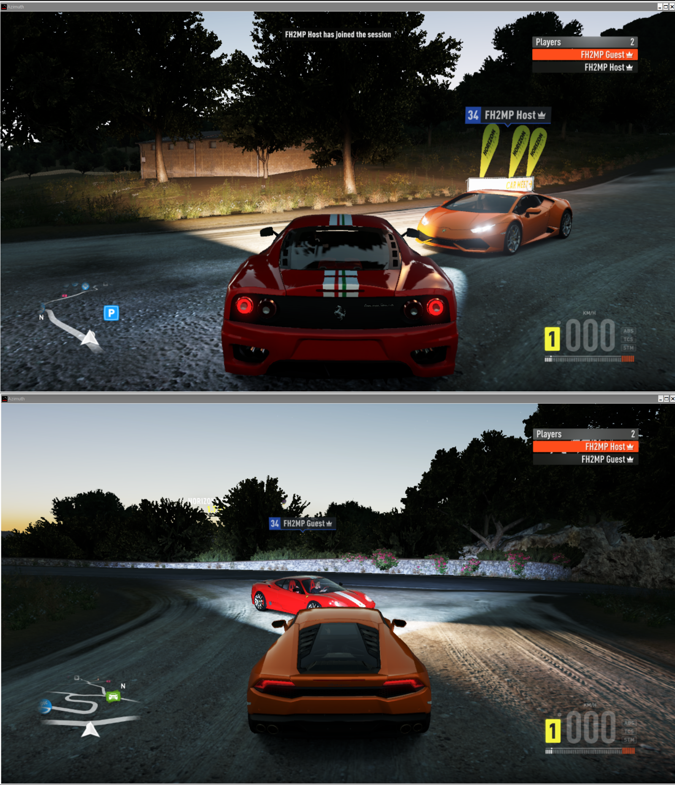

# FH2MP: Forza Horizon 2 online, back from the dead (sort of)

> **Work in progress. Not ready for end users.**
> This is a research project with a working demo, not a product. Expect crashes, desyncs,
> hand-edited config files and the occasional "why is there a third car?". There is no installer,
> no support, and no promise that your game will survive contact with it.

On 2023-08-22 Microsoft switched off the online services for Forza Horizon 2, and the multiplayer
went with them. FH2MP is an attempt to bring it back: the **real game client**, talking the
**game's own network protocol**, to a **replacement server** we write ourselves.

## Demo: Online Free Roam, two real clients

Two instances of the game join one server and see each other in the open world:

- both players appear in the **Players** list with their own names, and a "joined the session" toast fires
- each player's car is relayed live (position, steering, wheels) and drawn in the other player's world
- the join flow, session objects, weather and clock are served by our server, not stubbed in the client

This runs on the game's own NetV2 stack (the UDP protocol the Xbox One build shipped with).
We did not write a new multiplayer mod on top of the game; we wrote the server the game expected
to find, and taught the client where it is.

## What does not work yet

- **Traffic is not shared.** Each client simulates its own AI traffic, so a traffic collision on one
  screen is not a collision on the other. A proper fix means running the game's traffic server for everyone.
- **Online events (races) do not start. Yet.** Lobby setup, ownership transfer, "race ready", participant
  selection and the start-race message are partly implemented; the client still never leaves the
  "event about to start" screen. Invites to other players are not working either.
- **Bucket List cars** do not appear online.
- **No reliability layer** on the server's side of the connection. Fine on loopback, untested anywhere else.
- Convoys, Car Clubs, Rivals, leaderboards, Drivatars, friends, invites, voice: none of it, yet.
- Only tested on one setup (see below). Windows, other Azimuth versions and other game builds are unknown territory.

## How it works, briefly

| Piece | What it does |
|-------|--------------|
| **Azimuth** (third party, not included) | A compatibility layer that runs the Xbox One build of FH2 on a PC. It stubs every online call as "offline". |
| **`shim/`** | A small in-process DLL that replaces Azimuth's `azimuth-tls.dll` helper. It keeps the helper's job, re-enables real sockets, passes launch options to the game, and patches a few spots (for example, keeping the traffic module in single-player mode). |
| **`server/`** | A Python server that speaks NetV2: handshake, acks, object sync, session/lobby/weather objects, and relaying one client's objects and car state to the others. |

The protocol was recovered from the client itself, not from captured Microsoft traffic.
No Microsoft or Xbox Live service is contacted, ever. There was nothing left to sniff.

## Requirements (what it was actually tested on)

- A **legitimately owned copy** of Forza Horizon 2 (Xbox One build **1.0.0.64**). No game files are in this repo and none ever will be.
- **Azimuth 0.9.7** (the shim's hooks are checked against byte signatures from that build and skip anything that does not match).
- Optionally the **FH2 Extra Options** mod: the shim chain-loads it if you rename its DLL (see below).
- Linux with Wine/Proton (CachyOS, Proton-CachyOS 11). Windows should work in principle, but is untested.
- `python3` (standard library only) for the server; `x86_64-w64-mingw32-gcc` to build the shim.

## AI disclosure

This project is **AI-assisted**. If that makes you want to close the tab: fair enough, that is your call. But people also once argued against the loom, the steam engine, the telephone, the automobile and the smartphone, and yet here we are,
reading this on a screen built in a factory, powered by a grid, delivered over a global network. A tool that helps one person get through work that used toneed a team and a month is still just a tool, and the output is still judged the old way: does the client connect, does the packet decode, does the car show up on the other screen. Bugs are ours either way.

## Legal and ethics

- Unofficial fan research for interoperability with a game you own. Not affiliated with or endorsed by
  Microsoft, Turn 10, Playground Games, or the Azimuth developer.
- No game files, Azimuth binaries or extracted assets are included or may be contributed.
- The server only talks to clients you point at it. It never contacts Microsoft or Xbox Live services.

## Related projects

- **Azimuth** by Almost There Games: the layer that makes any of this possible.
- **FH2 Extra Options** by RokkuDayo: quality-of-life patches; compatible with the shim's chain-loading.

## License

[GPL-3.0](LICENSE). The game, Azimuth and the other mods mentioned above belong to their respective authors and are not covered by it.
