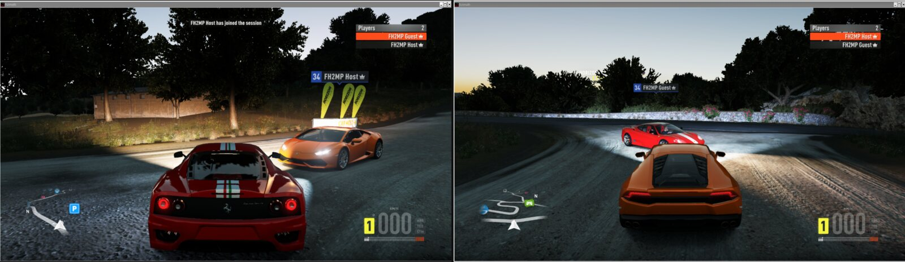
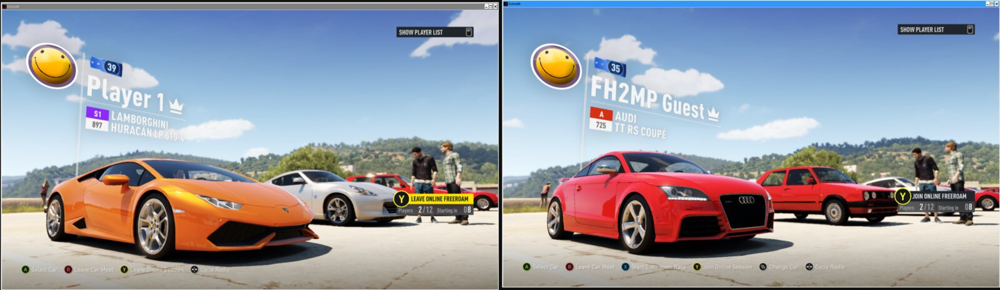
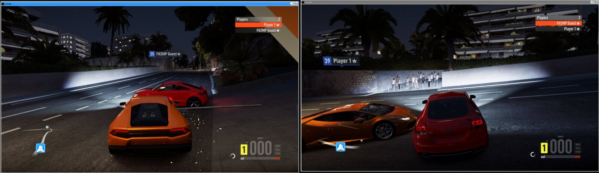
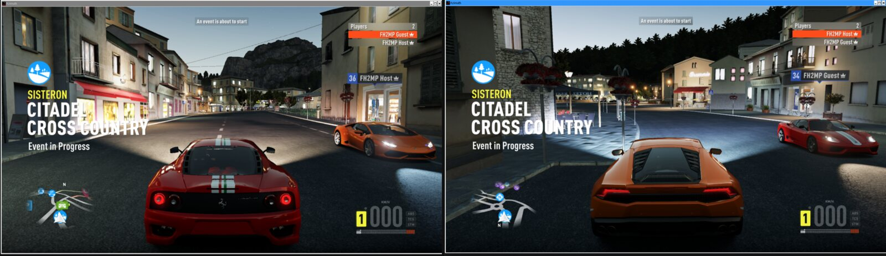
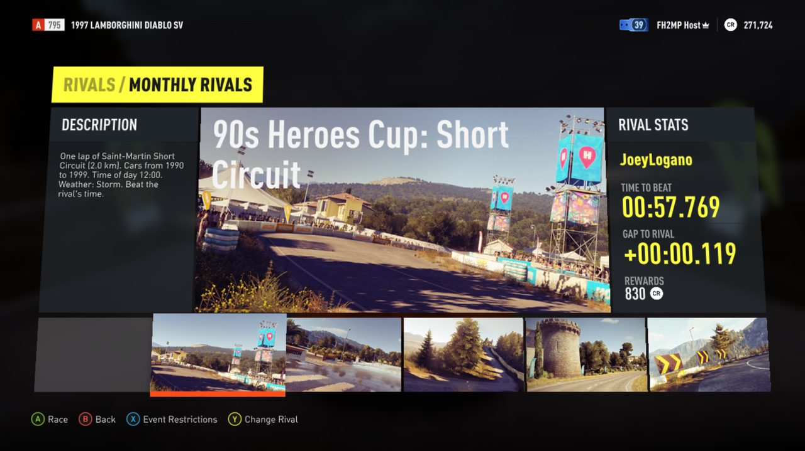
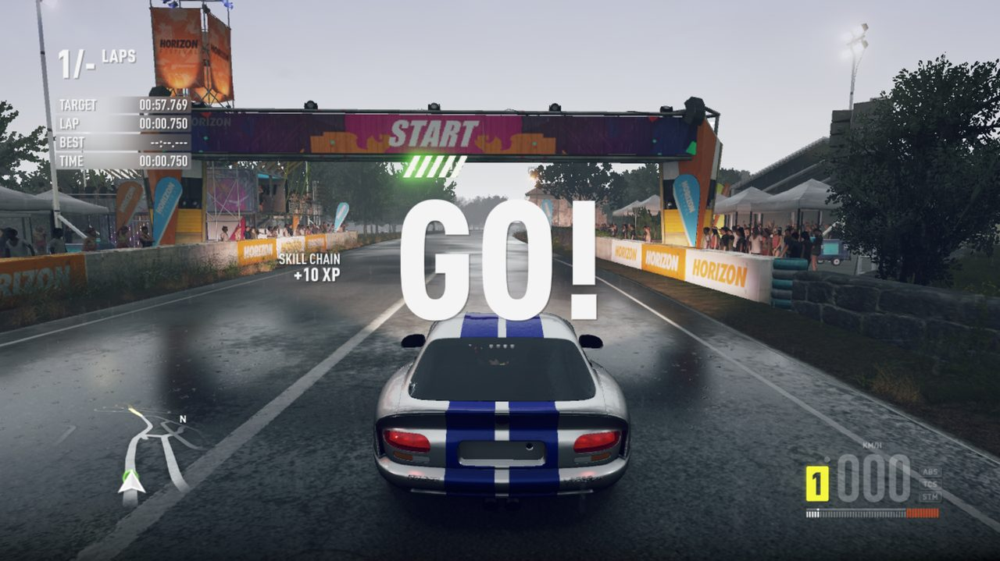
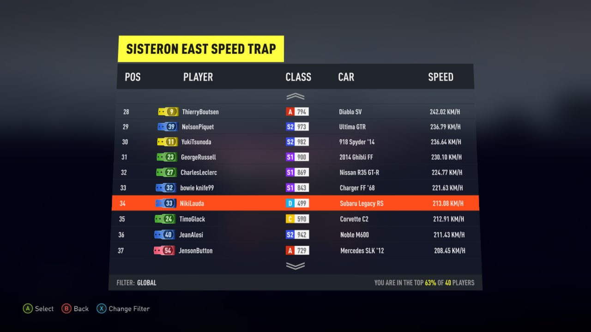
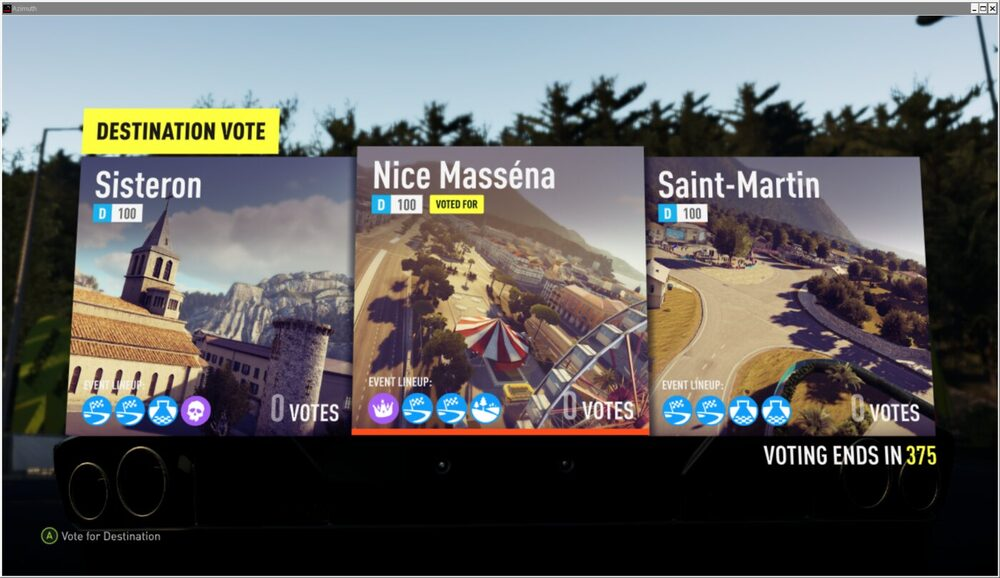

# FH2MP: Forza Horizon 2 online, back from the dead (sort of)

> **Work in progress, not for end users.** A research project with a working demo: no installer, no support,
> expect crashes, desyncs and hand-edited config files.

Microsoft switched off Forza Horizon 2's online services on 2023-08-22. FH2MP brings them back: the **real game
client**, speaking the **game's own network protocol**, to a **replacement server** written from scratch.

## Screenshots

Every shot is from real game clients running against our server. The wide strips show two clients side by side.

<table>
<tr><td colspan="2"> Car Meet: one player starts Online Free Roam, the other gets the invite and a countdown.</td></tr>
<tr><td colspan="2"> After the invite: both in the same Free Roam world, found through the game's own matchmaking.</td></tr>
<tr><td colspan="2"> Online event: invite, car select, starting grid and race, both cars on track.</td></tr>
<tr>
<td width="50%"> Monthly Rivals, generated by our server: track, era restriction, time of day, weather, rival and reward.</td>
<td width="50%"> The same event in game: the storm setting gives rain and a wet track; the rival's time is on the HUD.</td>
</tr>
<tr>
<td width="50%"> Speed trap leaderboard: Global filter, real cars and speeds, "top 63% of 40 players".</td>
<td width="50%"> Online Road Trip vote: three random destinations built from the game's own event table.</td>
</tr>
</table>

## Progress

Percentages are a rough, honest estimate of how close each feature is to the original service, not a measurement.
The multiplayer features were tested with two local clients; the cloud features (Rivals, leaderboards, Message Center)
mostly with one, plus a two-client check of the Rivals ghost and notification loop.

| Feature | Progress | State |
|---------|----------|-------|
| **Online Free Roam** | `█████████░` 90% | Join, Players list, name tags, live car relay. No reliability layer yet. |
| **Matchmaking** (the game's own flow) | `███████░░░` 70% | Per-client identity, many lobbies of every type at once, full lobbies (12) roll over. A startup race sometimes ends in "config server error" (relaunch). |
| **Car Meets** | `██████░░░░` 60% | Meet, see each other's cars, invite to Online Free Roam. Missing: Showdown races, Road Trip invites (untested), shared Drivatar crowd. |
| **Online events** | `███████░░░` 70% | A sprint runs end to end, including the 30 s last-finisher timer. Missing: circuit end detection, events started by the second player (softlock), results flow. |
| **Online Road Trip** | `████░░░░░░` 40% | Vote, car select, group drive, race and XP championship screens work. Moving on through all four events of a destination is not done. |
| **Event scoreboard and progress** | `██████░░░░` 60% | Lap times, progress and positions are relayed. Position order only checked on one-lap events. |
| **Car-to-car collisions** | `█████░░░░░` 50% | Hits are relayed and look right; slow pushing still gives small periodic bumps. |
| **Message Center and Community News** | `████████▌░` 85% | Server messages show up in both. Missing: personal inbox, a few message types. |
| **Drivatars** | `██████░░░░` 60% | Cache served, your own Drivatar uploaded. Limited variety; each client builds its own Car Meet crowd. |
| **Traffic sync** | `██████░░░░` 60% | Traffic cars are shared between clients. Traffic collisions and ownership hand-off still need work. |
| **Rivals** | `████████▌░` 85% | Monthly events generated by the server, real or made-up rivals, ghosts, notifications, rewards (details below). DLC pages out of scope. |
| **Leaderboards** | `███████▌░░` 75% | Speed trap and event boards, Global / Friends / Near Me, "top x% of N players". Missing: club boards, a real friends list. |
| **Reliable delivery** | `█░░░░░░░░░` 10% | Fine on loopback, untested on a real network. |
| **Bucket List cars online** | `░░░░░░░░░░` 0% | Not started. |
| **Friends, presence, join-in-progress** | `░░░░░░░░░░` 0% | Not started. |
| **Car Clubs** | `░░░░░░░░░░` 0% | Not started. |
| **Tunes and paint jobs** | `░░░░░░░░░░` 0% | Not started. |

**Overall, "find a friend through a Car Meet, play Online Free Roam and an event" is at roughly 70%.** The rest is the long tail.

**Rivals in more detail.** Turn 10 curated the Monthly Rivals events and that content is gone for good, so the server
generates them: each month (or on an admin re-roll) it picks 12 closed circuits, one lap each, with a random restriction
(class, body style, brand, era, drive type, country or a single car), and a time of day and weather on many of them.
The rival is a real player with a ghost when one exists, otherwise a made-up driver with a believable time derived from
the route length and car class. Ghosts upload and play back, getting beaten sends a "beat you" notification under My
Rivals, and each new rotation sends a rival recommendation. Showcase, Festival Routes, My Rivals and rewards work.
Not done: DLC rival pages, the Road Trip rival tab (unchecked). Leaderboards are padded with made-up players so they are
never empty; the Friends filter shows only you for now.

## Other known gaps

- Tested on one setup only (below), with two clients. Real networks, NAT, more players and Windows are unexplored.
- Sessions are lost when the server restarts; clients have to matchmake again.

## How it works

| Piece | What it does |
|-------|--------------|
| **Azimuth** (third party, not included) | Runs the Xbox One build of FH2 on a PC and stubs every online call as offline. |
| **`shim/`** | A small in-process `winmm.dll` proxy. Re-enables real sockets, gives each install its own identity, lets the game's matchmaking and online Car Meet run, completes the QoS, secure-address and token steps, passes launch options, and patches a few gates (for example the Rivals "race this event" check). `shim/fh2dbg.py` is a live debugger client for it. |
| **`server/`** | Python. `fh2mp_server.py` speaks the game's NetV2 UDP protocol (lobbies, worlds, relay; standard library only). `fh2mp_lsp.py` stands in for the HTTP cloud services (Message Center, Drivatars, Rivals, scoreboards, user content, permissions, economy), `xbl.py` for the Xbox Live session, matchmaking and game-server services. The LSP needs `psycopg` 3. |

Everything server-side runs centrally on one VPS. State lives in PostgreSQL: scores, ghosts, Drivatars, notifications, Rivals events
and user-made paint jobs in `public`, and a "game catalog" (game tables, English strings, route geometry, the web-service schemas,
the shipped Drivatars) in the schema `game`. The catalog is built once from your own install with `tools/export_gamedata.py` and
loaded with `tools/load_gamedata_pg.py`; the running server never touches game files, and the catalog is never committed or shipped.
Backups (WAL archiving for point-in-time recovery, hourly/daily/weekly dumps) and restore are in `docs/ops.md`.

The protocol was recovered from the client itself, not from captured Microsoft traffic. No Microsoft or Xbox Live
service is contacted, ever. There was nothing left to sniff.

## Requirements (what it was actually tested on)

- A **legitimately owned copy** of Forza Horizon 2, Xbox One build **1.0.0.64**. No game files are in this repo.
- **Azimuth 0.9.10**. The shim checks its hooks against byte signatures from that build and skips anything that does not match.
- Optional: **FH2 Extra Options 0.2.88**. Put its `Azimuth/winmm.dll`, ini and PNG in an `fh2extra` folder next to `azimuth.exe`; the shim chain-loads it.
- `shim/build.sh` (needs `x86_64-w64-mingw32-gcc`) builds `shim/build/winmm.dll`. Place it next to `azimuth.exe` and launch with `WINEDLLOVERRIDES=winmm=n,b`.
- Linux with Wine/Proton (tested on Proton-CachyOS 11). Windows should work in principle, untested.
- `python3` for the servers; the LSP additionally needs PostgreSQL 16 and `psycopg` 3 (see `docs/ops.md`).

## AI disclosure

This project is **AI-assisted**. If that makes you close the tab, fair enough. It is a tool that lets one person get
through work that used to need a team, and the output is judged the old way: does the client connect, does the packet
decode, does the car show up on the other screen. The bugs are ours either way.

## Legal and ethics

- Unofficial fan research for interoperability with a game you own. Not affiliated with or endorsed by Microsoft,
  Turn 10, Playground Games or the Azimuth developer.
- No game files, Azimuth binaries or extracted assets are included or may be contributed.
- The server only talks to clients you point at it and never contacts Microsoft or Xbox Live services.

## Related projects

- **Azimuth** by Almost There Games: the layer that makes any of this possible.
- **FH2 Extra Options** by RokkuDayo: quality-of-life patches, compatible with the shim's chain-loading.

## License

[GPL-3.0](LICENSE). The game, Azimuth and the mods mentioned above belong to their respective authors and are not covered by it.
